### Hi, I'm Yong Zhen.

I'm an AI engineer and full-stack developer. My final-year project taught a neural network to spot domains generated by malware and to show, character by character, why it thought so. At work I build a multi-tenant business platform end to end, from Postgres row-level security to the screens people use every day.

I care about software that can account for itself: a model that explains its verdict, a system that keeps every company's data sealed off, a change that arrives with the test that proves it.

**Toolbox** · TypeScript · Python · NestJS · Next.js · React · GraphQL · PostgreSQL · Django · Keras · SwiftUI

**Say hello** · [LinkedIn](https://www.linkedin.com/in/tan-yong-zhen-b4002a228) · [tanyongzhen2002@gmail.com](mailto:tanyongzhen2002@gmail.com)

My repositories are private, so this page shows counts, never names. The figures come from GitHub's own contribution data.
